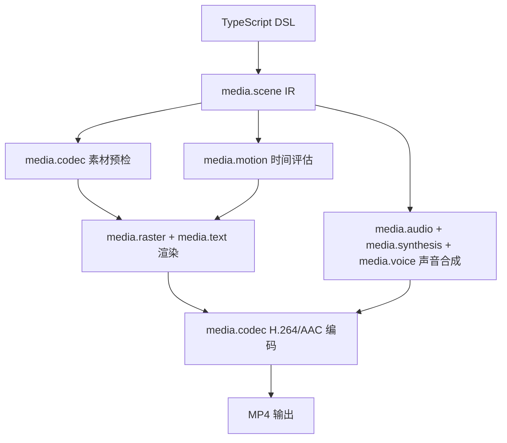

# OpenCut

**Code-first 视频编辑器** — 一段视频就是一个 TypeScript 数据结构，渲染是一个 compile step。不用 Adobe Premiere，不用 FFmpeg shell。

## ✂️ 核心能力

- **DSL 作者面** — `Film` / `Scene` / `text` / `code` / `counter` / `shape` / `image` / `video` / `chart` / `callout` / `path` / `layer` / `instance`，秒级编写
- **时间化动画** — `id` + `anim` + `follow` 时间窗，运动评估在 `media.motion` 核心里
- **程序合成声音** — effect 八家族（whoosh/impact/riser/tick/glitch/sub/ambience/sparkle），17 种乐器（9 鼓 8 音），8 种鼓 groove，歌声合成（5 元音 × onset class）
- **设计令牌** — 声明 `$role` 语义颜色，project/scene override + locked 防覆盖
- **素材预检** — 缺失/不可解码素材 preflight 拒绝，不会悄悄产出半成品
- **确定性输出** — 同 spec + seed = byte-identical MP4

## 🚀 快速上手

CLI:

```bash
open-cut render films/demo.ts -o out/demo.mp4
open-cut preview films/demo.ts --frame 90 -o frame.png
open-cut build                          # 看 native 版本和 source revision
```

库调用:

```ts
import { Film, colorToken, text, image } from '@wae/open-cut';

const film = new Film({ width: 1280, height: 720 })
    .design({ colors: [{ role: 'ink', value: '#e9f0fb' }] })
    .scene({
        duration: 3,
        items: [text({ at: 0, dur: 3, content: 'Hello', color: colorToken('ink') })],
    });
```

参考示例：`films/demo.ts`、`films/design-tokens.ts`、`films/voice-sfx.ts`、`films/groove.ts`。

## 🏗️ 作者面管线



场景 IR、motion、raster、text、audio synthesis、codec 全在共享中立 `media.*` tree。本仓库只保留作者面和 N-API binding，**不**有第二个 renderer。

## 🖥️ 平台说明

全平台原生包（Windows x64 / Linux x64 / Linux arm64 / macOS x64 / macOS arm64）。**MP4 编码走 Windows Media Foundation**，完整渲染链需要 Windows。Media Foundation 在所有主流 Windows 版本都有，N/KN 版需要 Media Feature Pack。

## ❌ 暂不支持

- 场景间转场（硬切）
- 多轨合成（items 按列表顺序绘制，一 scene 一 scene）
- 语音旁白合成（歌声合成已实现，旁白是 slot 不是 generator）
- 任意 property curve（只支持 motion 字段）
- WASM / 浏览器执行
